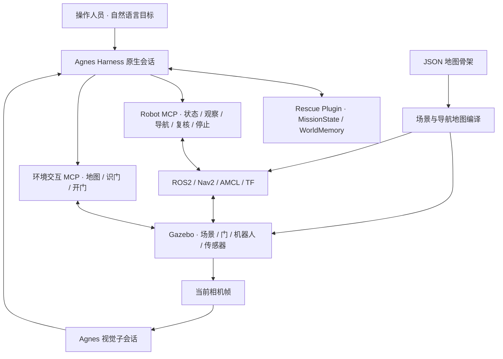

# 具身救援 · 从指令到行动

**Agnes Embodied Rescue** 面向具有已知地图骨架的室内人员搜寻场景。我们将自然语言目标、Agnes 多模态视觉、地图定位和动作反馈连接起来，在 Gazebo 仿真环境中实现环境观察、导航、房门操作、人员接近与复核。

> 任务示例：**“请找到一个待救援人员。”**

[观看演示视频](https://www.bilibili.com/video/BV1F1J66YEkB/) · [系统结构](#系统结构) · [安装与运行](#安装与运行) · [测试](#测试) · [上游来源](UPSTREAM.md)

2026年江苏省AI+科学与工程创新实践黑客松高校组参赛项目

**硕博组 G002 · 今天不想做正事**

## 项目目标

室内搜寻需要处理房间连接、关闭的房门、视线遮挡以及不确定的人员线索。我们希望操作人员通过远程对话下达目标，由机器人结合空间骨架和新的现场观察组织行动。

当前成果在仿真环境中验证，已集成**经典地图**和**室内办公室**两种布局。办公室包含四个房间、走廊、电脑工位、初始关闭的可交互房门，以及用于视觉演示的火焰和烟雾。

## 主要能力

| 能力 | 实现方式 |
| --- | --- |
| 自然语言任务入口 | AGH 原生 Web 会话结合工具、任务状态和观察结果组织行动 |
| 多模态现场理解 | 当前相机图片输入 Agnes 视觉子会话，识别人员、房门等线索 |
| 定位与导航 | ROS2、激光、里程计、AMCL 和 TF 提供位姿，Nav2 执行导航 |
| 房门交互 | 近门视觉检查、把手与侧铰链开门动画、门扇角度及动作终态核查 |
| 主动观察与复核 | 原地环视、获取新相机帧和针对目标进行多视角检查 |
| 地图骨架复用 | JSON 描述房间、走廊、墙体、门洞、起点与障碍，编译场景和导航地图 |
| 状态与记忆 | MissionState 管理任务进度；WorldMemory 保存区域、线索及行动历史 |
| 实时展示 | 原生对话、机器人第一视角与实时位置导航同屏展示 |

任务组织和视觉理解均使用 **Agnes `agnes-3.0-flash`**。我们对随附 Harness 做了图像能力透传、MCP 图像及产物投影、Web/worker 接口等本地适配；当前源码已包含这些修改。

## 系统结构



### 从任务到动作

1. 操作人员在 AGH 原生对话中提出目标。
2. 任务会话读取当前状态、已知区域、位姿和现场观测，选择后续工具。
3. 机器人执行导航、观察或门操作；异步任务通过同一操作编号持续跟踪。
4. 系统读取实际终态和新相机帧，核查动作结果并更新任务记忆。
5. 对人员线索进行新视角复核，核查机器人停止状态。

Robot MCP 的八个高层工具：

`get_robot_state` · `get_world_state` · `get_observation` · `navigate_to` · `inspect_room` · `inspect_object` · `stop_robot` · `list_known_locations`

### 视觉与定位

视觉子会话分析当前图像，返回标签、像素位置和模型置信度。地图坐标来自激光定位、里程计与 TF；我们结合视觉线索、语义区域和机器人位姿选择下一处观察位置。当前视角未见人员，不代表整个区域无人。

### 地图与场景记忆

骨架上传、命名和预览不会自动启动导航。实际切换需要显式确认，并检查任务空闲、运动锁、新地图、TF 和相机状态。

我们采用**程序化仿真与结构化场景记忆**：Gazebo 维护几何和物理状态，WorldMemory 保存任务过程中的知识。当前实现尚未训练预测未来图像或动力学的生成式世界模型。

## 仓库结构

| 目录 | 内容 |
| --- | --- |
| [packages/embodied-rescue-plugin](packages/embodied-rescue-plugin) | Rescue Plugin、技能、任务记忆与测试 |
| [services/robot-mcp](services/robot-mcp) | 八工具接口、ROS 网关、导航、视觉与运动控制 |
| [services/environment-interaction-mcp](services/environment-interaction-mcp) | 地图和房门交互服务 |
| [scripts/agnes-proxy](scripts/agnes-proxy) | Harness 接入、Web 与 WebSocket 代理 |
| [scripts/demo-ui-final](scripts/demo-ui-final) | 状态监控、会话观察及场景切换 |
| [demo/final-dashboard](demo/final-dashboard) | 实时界面、地图与媒体页面 |
| [scripts/map-import](scripts/map-import) | 骨架校验、场景与导航地图编译 |
| [scripts/interactive](scripts/interactive) | 场景管理、相机、任务执行与验收 |
| [simulation](simulation) | Gazebo 世界、导航参数、程序化材质及人物资产 |
| [maps/imported](maps/imported) | 地图骨架与编译资产，含历史布局 |
| [runtime/ros2-jazzy](runtime/ros2-jazzy) | Pixi 环境定义与锁文件 |
| [third_party/agnes-harness](third_party/agnes-harness) | 固定基线及本项目适配后的完整 Harness 源码 |

历史实验和阶段性脚本随源码保留；当前展示页面使用经典地图与室内办公室。上游基线和本地修改范围见 [UPSTREAM.md](UPSTREAM.md)。

## 安装与运行

### 环境要求

| 项目 | 当前演示环境 |
| --- | --- |
| 操作系统 | Ubuntu / Linux x86_64 |
| Node.js | 24.10.0，根清单要求至少24.10 |
| pnpm | 10.34.5 |
| Pixi | 0.81.0 |
| 机器人软件 | ROS2 Jazzy、Nav2、Gazebo Sim 8 |
| 模型 | 授权的 Agnes 接口与 agnes-3.0-flash |

现有服务器已完成运行验证；全新机器的独立部署尚未完成验证。多个脚本仍使用 `/data-ssd/zhongchengkai/agnes` 固定路径，迁移时需要检查路径、依赖、AMCL overlay、模型配置与启动入口。

### 1. 获取源码

```bash
git clone https://github.com/Emzit/Agnes_Embodied_Rescue.git
cd Agnes_Embodied_Rescue
```

Harness 源码已直接纳入 `third_party/agnes-harness`，无需另外初始化 Git submodule。

### 2. 准备工具与依赖

按上述版本准备官方工具链。现有脚本主要从 `tools/node/bin/node` 和 `tools/pixi/bin/pixi` 读取可执行文件，这些已安装工具不随 Git 仓库分发。先使 pnpm 可用，再安装锁定依赖：

```bash
source scripts/use-local-toolchain.sh

pnpm --dir third_party/agnes-harness install --frozen-lockfile
pnpm --dir services/robot-mcp install --frozen-lockfile

tools/pixi/bin/pixi install --locked \
  --manifest-path runtime/ros2-jazzy/pixi.toml

pnpm --dir third_party/agnes-harness --filter @agnes/cli build:local
```

Harness 构建和模型配置参考随附的[安装指南](third_party/agnes-harness/docs/guide/install.zh-CN.md)与[首次运行说明](third_party/agnes-harness/docs/guide/quickstart.zh-CN.md)。运行本项目时，核心任务与视觉均选择 Agnes 模型。

模型 API Key、账号 Profile、会话数据库、daemon 连接信息和本机 ROS 环境由部署者单独准备。办公室定位还需要核查 [office-localization.mjs](scripts/interactive/office-localization.mjs) 中的 AMCL overlay 配置。

### 3. 使用现有启动入口

完成路径和运行配置后，主要入口如下：

| 入口 | 用途 |
| --- | --- |
| `bash scripts/start-step7-agnes.sh` | 启动本项目 AGH Web |
| `bash scripts/final-rescue/start-stack.sh` | 启动机器人仿真栈 |
| `python3 scripts/demo-ui-final/start.py` | 启动或复用演示 UI、会话观察器与 ROS 监控 |
| `http://127.0.0.1:4177/demo` | 原生对话、机器人第一视角及位置导航 |

这些入口依赖已配置的项目运行环境。已有实例运行时先检查状态，避免重复启动。真实导航任务通过页面对话发起。

远程访问需要转发4177端口和当前 AGH daemon 实际使用的 WebSocket 端口，以运行环境中的实际端口为准。

### 4. 发起任务

在页面确认相机、定位与导航状态后，创建新会话并发送：

> 请找到一个待救援人员。

我们将人员线索搜寻与开门入室、接近及复核分别核查。若需要后者，应在任务中明确要求这些动作，并保留追加指令记录。

## 测试

以下19项离线边界回归覆盖导航生命周期、视觉空结果、视觉回合和插件验收逻辑，不发起机器人导航或模型请求：

```bash
tools/node/bin/node --test \
  services/robot-mcp/tests/navigation-lifecycle.test.ts \
  services/robot-mcp/tests/perception-output.test.ts \
  services/robot-mcp/tests/vlm-turn.test.ts \
  packages/embodied-rescue-plugin/tests/runtime-entry.test.ts
```

地图和场景资产测试入口：

- [办公室骨架测试](scripts/map-import/test_office_import.py)
- [栅格几何测试](scripts/map-import/test_raster_geometry.py)
- [办公室资产与验证说明](simulation/visual_assets/office_README.md)

部分历史集成脚本依赖本机 `artifacts` 中的运行记录；完整任务验收还需要真实仿真栈与模型配置。离线回归与真实任务成功率分别报告。

## 演示与验证范围

[公开演示视频](https://www.bilibili.com/video/BV1F1J66YEkB/)包含技术动画与两阶段实录：

- **阶段一：自主搜寻。**机器人回到出生点、房门关闭，新会话仅接收一句人员搜寻任务，由模型选择行动并获得人员线索。
- **阶段二：追加指令复核。**在同一现场追加开门、入室、接近、多视角复核和停止要求，分别核查物理子目标。

我们保留原生任务的部分完成结果、导航失败与相机异常记录；模型回合结束状态、工具终态与物理子目标结果分别核查。

当前火焰和烟雾用于视觉演示，未计算燃烧、温度或毒气传播。当前成果是仿真人员搜寻、接近与视觉确认，尚未完成真机火场部署、人员搬运或撤离。

## 运行记录与素材

本仓库交付代码、配置、依赖锁文件和程序化场景资产。模型凭据、GitHub 登录信息、会话数据库、原始轨迹、提交材料、个人联系方式、原始录像和已安装环境不纳入公开源码。

`/demo-project-film-*`、`/demo-submission` 等交付页面依赖本机 `artifacts` 中的媒体或材料；干净克隆不包含对应视频和提交包。功能演示通过上面的公开视频查看。

程序化办公室、材质、房门、人物与火灾资产的来源和使用范围见 [simulation/visual_assets](simulation/visual_assets)。演示片中的技术动画、剪辑和后期旁白属于视频制作环节。我们在开发中使用 AI 辅助编码、调试、测试与材料整理。

## 第三方来源与许可

- [Agnes Harness](https://github.com/AgnesAI-Labs/agnes-harness)：上游基线 `fe90962a6b8561d8cae7e5d451905604fcf475cf`，保留其 [Apache-2.0 许可证](third_party/agnes-harness/LICENSE)。
- ROS2、Nav2、Gazebo、MCP SDK、Node.js、Pixi 等组件按各自上游许可使用。
- 第三方字体和素材保留对应来源及许可记录。
- `packages/embodied-rescue-plugin` 的包元数据声明 MIT；仓库根目录尚未设置覆盖全部项目自有代码的统一许可证。
- 上游公开测试目录中的假 Token 和 localhost TLS fixture 用于测试，不是实际运行凭据。

更多来源与适配说明见 [UPSTREAM.md](UPSTREAM.md)。

## 后续工作

我们将扩展不同骨架、起点、遮挡与传感器异常条件下的测试，完善导航恢复和人员复核流程，并逐步对接真实机器人。
