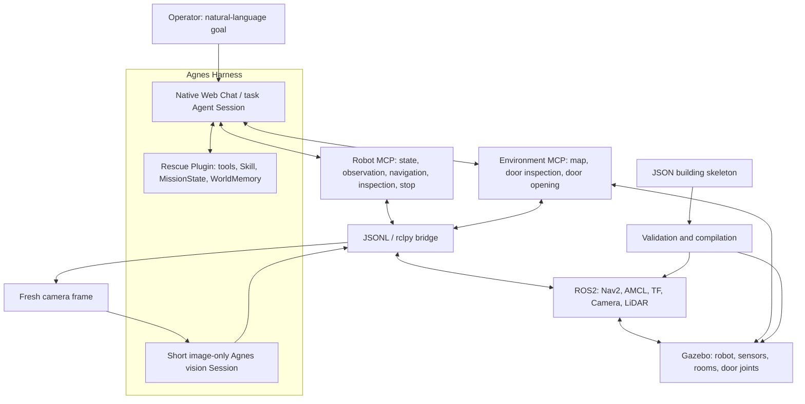

# Agnes Embodied Rescue

English | [简体中文](README.zh-CN.md)

### Embodied Rescue · From Instructions to Action

**Give the robot a goal. Let an Agent organize observation, navigation and verification.**

A simulation prototype for indoor personnel search in buildings with a known spatial skeleton, built on [Agnes Harness (AGH)](https://github.com/AgnesAI-Labs/agnes-harness), multimodal Agnes models, MCP, ROS2, Nav2 and Gazebo.

> “Please find a person who needs rescue.”

[Demo Video](#demo-video) · [Architecture](#architecture) · [Integration Standards](#integration-standards) · [Quickstart](#quickstart) · [Reproduction Guide](docs/REPRODUCING.md)

2026 Jiangsu AI + Science and Engineering Innovation Hackathon · Master's / Doctoral Division · G002 · 今天不想做正事

<details>
<summary>Contents</summary>

- [Project Overview](#project-overview)
- [Demo Video](#demo-video)
- [Architecture](#architecture)
- [Integration Standards](#integration-standards)
- [Quickstart](#quickstart)
- [Repository Map](#repository-map)
- [Validation and Current Scope](#validation-and-current-scope)
- [Roadmap](#roadmap)
- [Provenance and Licensing](#provenance-and-licensing)

</details>

## Project Overview

### The problem

Indoor search involves more than reaching a coordinate. The target's room may be unknown; doors may be closed; visibility may be limited; and a possible person may need a second look. Remote operation requires continuous attention, while a predefined room sequence cannot anticipate every observation or failure.

We connect a natural-language objective to an observable robot workflow. The task Agent combines the building layout, current sensor evidence and action results to choose where to look next, when to interact with a door, and whether a clue needs verification. Nav2 handles the continuous navigation underneath these task-level decisions.

### Core capabilities

| Capability | What we implement |
| --- | --- |
| Natural-language task entry | Operators give goals through the native AGH Web Chat; the same Session retains tool activity and results. |
| Multimodal observation | Current camera images are analyzed in short Agnes vision sessions for person, door and other visible-object clues. |
| Localization and navigation | ROS2, LiDAR, odometry, AMCL and TF provide pose information; Nav2 plans and executes motion. |
| Door interaction | Approach the registered interaction pose, visually inspect the door, open its Gazebo joint, and verify the measured result and new image. |
| Active perception and memory | Room scans and object reinspection provide additional views; MissionState and WorldMemory track progress, clues and failures. |
| Reusable map skeletons | JSON spatial descriptions compile into simulation geometry, navigation maps and semantic locations. The current demonstration layouts are Classic Map and Indoor Office. |
| Unified live interface | Native conversation, robot first-person view, and live position/navigation are displayed together. |

### What makes this approach useful

- **Task decisions beyond path finding.** The destination can emerge from observations rather than being supplied as a final coordinate. The Agent can revise the next task action after a blocked route or an uncertain detection; this is separate from Nav2's path replanning.
- **An observation–action–verification loop.** Issuing a command is not proof of success. Actual navigation terminal states, measured door motion and fresh visual evidence inform subsequent decisions.
- **Reusable task methods and execution adapters.** A rescue plugin packages tools, Skills and task memory; two MCP services expose robot and environment capabilities. This separation supports adapting the workflow without embedding a fixed room order in the Agent.
- **Spatial knowledge without revealing the answer.** The map supplies geometry and connectivity. Current personnel evidence comes from camera observations, not simulator-only target coordinates.

The current result is a **Gazebo-based personnel-search and visual-confirmation prototype**. It does not yet perform physical casualty extraction or operate in a real fire.

## Demo Video

### [Watch the project demonstration on Bilibili](https://www.bilibili.com/video/BV1F1J66YEkB/)

The video combines technical animation with recorded simulation operation. It shows the native task interface, robot camera view, map navigation, door interaction and personnel verification.

The recorded operation is presented in two stages: an initial one-sentence search task, followed by additional instructions for opening the door, entering, approaching and reinspecting the person. These stages should not be interpreted as one uninterrupted, single-prompt rescue run. Animation explains the system; recorded tool outcomes establish what happened in the simulation.

The public video is the demonstration entry point. Original recordings, session databases and machine-specific media delivery artifacts are not distributed in this source repository.

## Architecture

### Modules and responsibilities



Arrows show interfaces and data flow, not a fixed tool-call sequence. The Agent can call plugin tools and MCP tools independently; a plugin is not a mandatory forwarding layer for every robot command.

| Module | Responsibility | Implementation |
| --- | --- | --- |
| Agnes Harness | Native task sessions, model/tool execution, applicable approvals and execution records | Vendored AGH source with project integration patches; see [UPSTREAM.md](UPSTREAM.md). |
| Task Agent | Understand the goal, select tools, interpret feedback and revise the plan | Agnes `agnes-3.0-flash` in the task Session. |
| Rescue Plugin | Task-state and memory tools, evidence checks and reusable rescue methods | [Plugin entry](packages/embodied-rescue-plugin/index.mjs) and [Skill](packages/embodied-rescue-plugin/src/skills/embodied-rescue/SKILL.md). |
| Vision sessions | Analyze the supplied current image and return structured detections | [VLM worker](services/robot-mcp/perception/vlm-worker.mts), using the same Agnes model and the `sensor-image` preset. |
| Robot MCP | Eight high-level robot tools and the ROS2 gateway | [Tool server](services/robot-mcp/src/server.ts). |
| Environment MCP | Active-map topology, visual door inspection and joint-controlled opening | [Environment server](services/environment-interaction-mcp/server.ts). |
| ROS2 / Nav2 | Sensor communication, localization, transforms, path planning and continuous motion control | [Bridge](services/robot-mcp/ros2_bridge/bridge.py) and [navigation configuration](simulation/final_rescue/nav2_params.yaml). |
| Gazebo and map compiler | Simulate the robot/environment and generate assets from spatial skeletons | [Simulation](simulation) and [map importer](scripts/map-import/map_import.py). |

### From a goal to a verified result

1. An operator submits a goal in native AGH Chat. The Agent reads the current mission, memory, registered locations and relevant observations.
2. The Agent selects a useful next action from the current topology and evidence; the Skill does not prescribe a fixed room sequence.
3. A plugin tool updates task information, or an MCP tool requests observation, navigation or environment interaction.
4. Long-running navigation and room scans retain operation identifiers. The Agent follows the same operation until a terminal result is known, rather than repeatedly submitting motion commands.
5. New visual evidence and actual execution results are recorded in WorldMemory. The Agent continues, replans, verifies a clue or reports an incomplete task with its limitations.

### Vision, localization and control

The live camera stream is continuous; **multimodal inference is requested on demand**, not for every video frame or control cycle. A short vision session receives a current image and an image-only prompt, without the task's room history or hidden target positions. It returns labels, bounding boxes and confidence; it is not allowed to invoke tools.

Vision answers “what is visible?” Pose comes from the localization and TF chain. A detection's image coordinates do not by themselves establish its precise map coordinates. The current default Nav2 configuration uses the static map and LiDAR `/scan` for obstacle costmaps; camera/VLM detections are not directly inserted into those costmaps.

WorldMemory stores structured task knowledge. Gazebo maintains simulated physical state. We have not trained a generative world model that predicts future images or dynamics.

## Integration Standards

### 1. Harness plugin and Skill interface

The package declares its extensions in [`package.json`](packages/embodied-rescue-plugin/package.json) under `agnes.plugins`. The backend registers tools through `extension`; the Skill extension registers the `embodied-rescue` method through `skills`. A tool-result hook checks target evidence before confirmed-target memory updates.

The five plugin tools are `mission_get_state`, `mission_reset`, `world_memory_get`, `world_memory_update` and `decision_score_candidates`. These manage task information; robot motion remains behind the MCP execution interfaces.

### 2. Model Context Protocol (MCP)

Both services use **MCP over stdio**, the TypeScript MCP SDK (`1.25.2` in the Robot MCP manifest), JSON Schema tool descriptions and Zod input validation. The managed server IDs are `robot-mcp` and `envdoor`. JSON results are returned as MCP tool content and structured content, with image content where applicable.

| Service | Exposed tools |
| --- | --- |
| Robot MCP | `get_robot_state`, `get_world_state`, `get_observation`, `navigate_to`, `inspect_room`, `inspect_object`, `stop_robot`, `list_known_locations` |
| Environment MCP | `get_map`, `inspect_door`, `open_door` |

Typical argument shapes are `navigate_to({"location":"<current registered ID>"})`, `inspect_object({"object_id":"<current detection ID>"})` and `inspect_door({"door_id":"<current map door ID>"})`. These are argument illustrations, not commands to copy with literal placeholder IDs. Discover valid IDs through `list_known_locations`, `get_map` and current observations.

For a closed door, follow the dependent sequence: **get the active map → navigate to the door's interaction location → confirm arrival → inspect the door → open it → use post-motion evidence**. Do not run these dependent actions in parallel.

The two managed launchers are [`mcp-launch.mjs`](scripts/final-rescue/mcp-launch.mjs) and [`environment-interaction-launch.mjs`](scripts/final-rescue/environment-interaction-launch.mjs). The real robot backend uses `ROBOT_GATEWAY=ros2`; historical mock entry points are not equivalent to a live simulation.

### 3. Robot transport and ROS2 interfaces

The Node gateway and Python `rclpy` bridge exchange newline-delimited JSON requests using `id`, `method` and `params`; replies correlate the same `id` and carry `ok` plus `result` or an error code. This is a **project-internal transport**, distinct from MCP.

ROS2 integration uses Nav2 actions (`NavigateToPose` / `NavigateThroughPoses`), `Twist` motion commands, camera `Image`, LiDAR `LaserScan`, odometry and TF transforms. Navigation goals use the `map` frame; local odometry uses `odom`; the robot frame is `base_link`. Geometry follows ROS SI conventions, with distances in meters and yaw in radians. The default stack isolates ROS and Gazebo using its project-specific domain and partition.

An asynchronous navigation result may be `PENDING`. Poll `get_robot_state` for the matching `navigation_operation_id` until `navigation_terminal_known` is true, then read the actual terminal state. A room scan similarly retains `inspection_id`. Do not treat a transport timeout, idle motion or a completed model turn as task success.

### 4. Visual-evidence contract

The image-only response contains `detections`, each with `label`, `confidence` in `[0,1]` and a normalized `bbox` of `[x1,y1,x2,y2]`; no detections is represented by `{"detections":[]}`. The ROS adapter projects boxes into pixel coordinates and attaches detection IDs and frame provenance. See the [output parser](services/robot-mcp/perception/vlm-output.ts) and [camera adapter](services/robot-mcp/ros2_bridge/perception.py).

The rescue method requests reinspection for actual detections below `0.80`. Tool execution success alone does not verify a person; evidence must support confirmation, and an uncertain result remains a clue. This threshold is an application rule, not a calibrated real-world safety guarantee.

### 5. Building-skeleton exchange

Our **project-defined** JSON format uses `schema: "agnes.building_skeleton.exchange.v1"` and `coordinate_frame: "map"`. It describes boundaries, rooms, corridors, walls, doors, static obstacles and start poses. It is not an industry certification or a declaration of MHS compatibility.

The importer validates geometry and connectivity, then generates Gazebo SDF, an occupancy-grid PGM/YAML map, Nav2 parameters, semantic locations and interaction registries. See the [office skeleton](maps/imported/office_fire/office_skeleton.json) and [compiler](scripts/map-import/map_import.py).

Geometry and initial conditions are priors, not proof of live door state or target presence. Uploading/previews do not activate a scene. Physical switching requires explicit confirmation and idle-task, navigation and motion-lock checks; the new map, pose, camera and Session association are checked afterward.

**Integration scope:** this project currently connects devices through custom MCP services and ROS2/Gazebo. It does not integrate AgnesHub or implement an MHS/MOS device adapter.

## Quickstart

### Run the offline checks first

Requires Node.js **24.10+**; Python **3.12** is the tested Python version. These selected checks require neither model credentials nor a running simulator.

```bash
git clone https://github.com/Emzit/Agnes_Embodied_Rescue.git
cd Agnes_Embodied_Rescue

node --test \
  services/robot-mcp/tests/navigation-lifecycle.test.ts \
  services/robot-mcp/tests/perception-output.test.ts \
  services/robot-mcp/tests/vlm-turn.test.ts \
  packages/embodied-rescue-plugin/tests/runtime-entry.test.ts

python3 -B -m unittest discover \
  -s services/robot-mcp/tests -p 'test_doorway_navigation.py'
```

The selected suite covers navigation lifecycle, visual-output parsing, vision-turn handling, plugin boundaries and doorway geometry: **19 Node tests and 6 Python tests**. Offline checks do not establish live-task success rates.

### Prepare the full simulation

The demonstrated environment uses Linux x86_64, Node.js 24.10, pnpm 10.34.5, Pixi 0.81.0, ROS2 Jazzy, Nav2, Gazebo Sim 8 and an authorized Agnes provider with `agnes-3.0-flash`.

Follow the [English reproduction guide](docs/REPRODUCING.md) or [中文复现指南](docs/REPRODUCING.zh-CN.md) for dependencies, plugin/MCP configuration, startup order, remote access and deployment caveats. A clean clone is not a one-command full deployment: some scripts retain original-workspace paths, and the office scene additionally needs an AMCL overlay and the native fire-rendering plugin build.

After configuration, the live interface is `http://127.0.0.1:4177/demo`. Start with a read-only pose query before submitting a motion task.

## Repository Map

| Path | Contents |
| --- | --- |
| [packages/embodied-rescue-plugin](packages/embodied-rescue-plugin) | Plugin tools, registered Skill, mission state, memory and evidence checks |
| [services/robot-mcp](services/robot-mcp) | Robot tool server, ROS2 gateway, vision and navigation |
| [services/environment-interaction-mcp](services/environment-interaction-mcp) | Map and door-interaction service |
| [scripts/agnes-proxy](scripts/agnes-proxy) | Native AGH Web and same-origin WebSocket integration |
| [demo/final-dashboard](demo/final-dashboard) | Chat, camera, live map and scene-management interface |
| [scripts/map-import](scripts/map-import) · [maps/imported](maps/imported) | Skeleton validation/compiler and layout examples |
| [scripts/interactive](scripts/interactive) · [simulation](simulation) | Runtime orchestration, simulation assets and navigation configuration |
| [runtime/ros2-jazzy](runtime/ros2-jazzy) | Robot environment manifest and dependency lock |
| [third_party/agnes-harness](third_party/agnes-harness) | Pinned upstream source with project adaptations |

## Validation and Current Scope

- Live integration has been exercised on the existing demonstration server; a full clean-machine deployment has not been independently validated.
- We retain partial tasks, navigation failures and camera failures as well as successful subgoals. Component `READY`, a finished model turn, a successful tool and a completed mission are separate states.
- Fire and smoke are visual effects. Real combustion, temperature/toxic-gas propagation, thermal avoidance and high-temperature hardware capability have not been validated.
- Current personnel detection is visual confirmation of a simulation target, not identity verification. Real-hardware search, casualty handling and evacuation remain future work.
- Credentials, account Profiles, session databases, raw traces and original recordings are not bundled. Historical local media/submission pages depend on artifacts outside the source distribution. Keep private configuration outside Git.

## Roadmap

Expand testing across layouts, start poses, occlusions and sensor failures; improve navigation recovery and target reinspection; then adapt to a real chassis and sensors and measure task success, latency and recovery in controlled physical environments. Industrial inspection and household object finding are possible applications of the same task loop, with scene-specific tools and validation.

## Provenance and Licensing

- Built on [Agnes Harness](https://github.com/AgnesAI-Labs/agnes-harness), pinned to `fe90962a6b8561d8cae7e5d451905604fcf475cf` with local integration patches. Its [Apache-2.0 license](third_party/agnes-harness/LICENSE) and notices are retained; see [UPSTREAM.md](UPSTREAM.md).
- ROS2, Nav2, Gazebo, the MCP SDK and other dependencies retain their own licenses. Asset provenance is documented under [simulation/visual_assets](simulation/visual_assets).
- The rescue plugin package declares MIT. The repository root does not currently assign a single license to all project-authored files; public source availability does not imply uniform licensing.
- Upstream test fixtures contain intentionally fake tokens and localhost TLS test material, not project runtime credentials. Development used AI assistance; technical animation, editing and narration are video-production elements.
