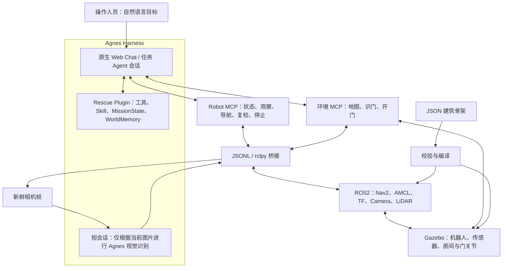

# 具身救援 · 从指令到行动

[English](README.md) | 简体中文

### Agnes Embodied Rescue

**给机器人一个目标，由 Agent 组织观察、导航与结果验证。**

面向已知地图骨架的室内人员搜寻仿真项目，基于 [Agnes Harness（AGH）](https://github.com/AgnesAI-Labs/agnes-harness)、Agnes 多模态模型、MCP、ROS2、Nav2 与 Gazebo 构建。

> “请找到一个待救援人员。”

[演示视频](#演示视频) · [系统架构](#系统架构) · [集成标准](#集成标准) · [快速开始](#快速开始) · [完整复现指南](docs/REPRODUCING.zh-CN.md)

2026 年江苏省 AI+科学与工程创新实践黑客松高校组参赛项目 · 硕博组 G002 · 今天不想做正事

<details>
<summary>目录</summary>

- [项目介绍](#项目介绍)
- [演示视频](#演示视频)
- [系统架构](#系统架构)
- [集成标准](#集成标准)
- [快速开始](#快速开始)
- [源码导航](#源码导航)
- [验证范围与当前边界](#验证范围与当前边界)
- [后续工作](#后续工作)
- [来源与许可](#来源与许可)

</details>

## 项目介绍

### 项目背景

室内搜寻不只是到达一个坐标。目标所在房间可能未知，房门可能关闭，视线可能受阻，疑似人员也可能需要换角度确认。遥控操作依赖人员持续看画面和控制动作，预设房间顺序则难以提前覆盖每一种现场变化与失败情况。

我们把自然语言目标连接到可以执行、观察和验证的机器人流程。任务 Agent 结合建筑布局、当前传感器证据和动作结果，选择下一处观察位置、判断何时操作房门、决定是否复核线索。任务层决策之下的连续导航由 Nav2 完成。

### 核心功能

| 能力 | 实现内容 |
| --- | --- |
| 自然语言任务入口 | 在 AGH 原生 Web Chat 下达目标，同一 Session 保留工具活动与结果。 |
| 多模态现场观察 | 将当前相机图片交给短视觉子会话，识别人员、房门及其他可见物体线索。 |
| 定位与导航 | ROS2、激光雷达、里程计、AMCL 与 TF 提供位姿，Nav2 规划并执行运动。 |
| 房门交互 | 到达已注册的交互位姿，视觉检查房门，控制 Gazebo 门关节，并核查实测状态与新画面。 |
| 主动感知与记忆 | 环视和目标复检补充视角；MissionState 与 WorldMemory 记录任务进展、线索和失败。 |
| 地图骨架复用 | JSON 空间描述编译为仿真几何、导航地图与语义位置；当前展示布局为经典地图和室内办公室。 |
| 实时综合界面 | 原生对话、机器人第一视角、实时位置与导航同屏显示。 |

### 方案亮点与实用价值

- **从寻路扩展到任务组织。**机器人不必事先知道最终目标坐标，可以根据观察逐步确定搜索位置。路线受阻或检测不确定时，Agent 可以调整下一项任务动作；这与 Nav2 的路径重规划分属不同层级。
- **观察—行动—验证闭环。**发出命令不等于执行成功，导航实际终态、门扇实测运动和新视觉证据共同支持后续判断。
- **任务方法与执行适配分开。**救援插件封装工具、Skill 和任务记忆，两个 MCP 服务提供机器人与环境能力，便于适配流程，避免在 Agent 中写死房间顺序。
- **使用空间先验，不泄露目标答案。**地图提供几何与连通关系，当前人员证据来自相机观察，而不是仿真内部的目标坐标。

当前成果是 **Gazebo 环境中的人员搜寻与视觉确认原型**，尚未实现真实火场作业或伤员搬运撤离。

## 演示视频

### [在 Bilibili 观看项目演示](https://www.bilibili.com/video/BV1F1J66YEkB/)

视频结合技术动画与仿真实录，展示原生任务入口、机器人相机、地图导航、房门交互和人员复核。

实录分为两个阶段：先以一句人员搜寻任务启动，随后追加开门、入室、接近与复核指令。这两个阶段不能理解为一条提示词触发的、不间断的完整救援。技术动画用于解释系统，仿真中的实际过程以工具结果为准。

公开视频是项目演示入口。原始录像、会话数据库和依赖本机产物的媒体交付文件不随本源码仓库分发。

## 系统架构

### 核心模块与分工



箭头表示接口与数据流，不是固定工具调用顺序。Agent 可以分别调用插件工具与 MCP 工具，并非每个机器人命令都必须先经过插件转发。

| 模块 | 职责 | 实现位置 |
| --- | --- | --- |
| Agnes Harness | 原生任务会话、模型与工具执行、适用的审批机制、执行记录 | 固定上游源码与本项目适配，见 [UPSTREAM.md](UPSTREAM.md)。 |
| 任务 Agent | 理解目标、选择工具、解读反馈并调整计划 | 任务 Session 中的 Agnes `agnes-3.0-flash`。 |
| Rescue Plugin | 任务状态与记忆工具、证据检查、可复用搜救方法 | [插件入口](packages/embodied-rescue-plugin/index.mjs)与 [Skill](packages/embodied-rescue-plugin/src/skills/embodied-rescue/SKILL.md)。 |
| 视觉子会话 | 分析输入的当前图片，返回结构化检测 | [VLM worker](services/robot-mcp/perception/vlm-worker.mts)，使用同一 Agnes 模型与 `sensor-image` 预设。 |
| Robot MCP | 八个高层机器人工具与 ROS2 网关 | [工具服务](services/robot-mcp/src/server.ts)。 |
| 环境 MCP | 当前地图拓扑、视觉识门与关节控制开门 | [环境服务](services/environment-interaction-mcp/server.ts)。 |
| ROS2 / Nav2 | 传感器通信、定位、坐标变换、路径规划与连续运动控制 | [桥接程序](services/robot-mcp/ros2_bridge/bridge.py)与[导航配置](simulation/final_rescue/nav2_params.yaml)。 |
| Gazebo 与地图编译器 | 仿真机器人和环境，根据骨架生成场景资产 | [仿真目录](simulation)与[地图导入器](scripts/map-import/map_import.py)。 |

### 从目标到结果的完整流程

1. 操作人员在 AGH 原生对话中提出目标，Agent 读取任务、记忆、已注册位置及相关观测。
2. Agent 根据当前拓扑与证据选择下一项有效行动，Skill 不规定固定房间顺序。
3. 调用插件工具更新任务信息，或调用 MCP 工具获取观察、执行导航或操作环境。
4. 导航和环视等异步动作保留操作编号，跟踪同一操作直到获得终态，避免重复下发运动命令。
5. 将新视觉证据和实际执行结果写回 WorldMemory，再决定继续、重新规划、复核线索，或如实报告未完成事项。

### 视觉、定位与控制的关系

实时相机持续传输，但**多模态推理按需调用**，不逐视频帧或逐控制周期执行。短视觉子会话只接收当前图片与图像识别提示，不接收主任务的房间历史或隐藏目标位置；返回类别、检测框和置信度，不允许调用工具。

视觉回答“看到了什么”，位姿来自定位与 TF 链路。图像上的目标坐标不直接等于其精确地图坐标。当前默认 Nav2 配置通过静态地图和激光 `/scan` 构建障碍代价地图，未将相机/VLM 检测直接写入代价地图。

WorldMemory 保存结构化任务知识，Gazebo 维护仿真物理状态。我们尚未训练用于预测未来图像或动力学的生成式世界模型。

## 集成标准

### 1. Harness 插件与 Skill 接口

插件通过 [`package.json`](packages/embodied-rescue-plugin/package.json) 的 `agnes.plugins` 声明扩展，后端经 `extension` 注册工具，Skill 扩展经 `skills` 注册 `embodied-rescue` 方法。工具结果 hook 会为“确认找到目标”的记忆更新核查证据。

五个插件工具为 `mission_get_state`、`mission_reset`、`world_memory_get`、`world_memory_update`、`decision_score_candidates`。它们管理任务信息，机器人运动仍由 MCP 执行接口承接。

### 2. 模型上下文协议 MCP

两个服务均采用 **MCP stdio 传输**、TypeScript MCP SDK（Robot MCP 清单锁定 `1.25.2`）、JSON Schema 工具描述与 Zod 输入校验。受管服务 ID 为 `robot-mcp` 和 `envdoor`。JSON 结果通过 MCP 工具内容及结构化内容返回，适用时携带图像内容。

| 服务 | 提供的工具 |
| --- | --- |
| Robot MCP | `get_robot_state`、`get_world_state`、`get_observation`、`navigate_to`、`inspect_room`、`inspect_object`、`stop_robot`、`list_known_locations` |
| 环境 MCP | `get_map`、`inspect_door`、`open_door` |

典型参数形式为 `navigate_to({"location":"<当前已注册位置ID>"})`、`inspect_object({"object_id":"<当前检测ID>"})`、`inspect_door({"door_id":"<当前地图房门ID>"})`。这些仅示意参数结构，不能直接使用占位 ID 执行；有效 ID 应从 `list_known_locations`、`get_map` 和当前观测取得。

对关闭房门按依赖顺序执行：**读取当前地图 → 导航到门外交互位置 → 确认到达 → 视觉识门 → 开门 → 使用动作后证据**，不能将有依赖关系的步骤并行调用。

受管启动器为 [`mcp-launch.mjs`](scripts/final-rescue/mcp-launch.mjs) 与 [`environment-interaction-launch.mjs`](scripts/final-rescue/environment-interaction-launch.mjs)。真实机器人后端使用 `ROBOT_GATEWAY=ros2`，历史 mock 入口不能等同于实时仿真。

### 3. 机器人传输与 ROS2 接口

Node 网关与 Python `rclpy` 桥接通过逐行 JSON 通信，请求包含 `id`、`method`、`params`，响应关联同一 `id`，并携带 `ok` 与 `result` 或错误码。这属于**项目内部传输**，不是 MCP 本身。

ROS2 接口包括 Nav2 的 `NavigateToPose` / `NavigateThroughPoses` Action、`Twist` 运动指令、相机 `Image`、激光 `LaserScan`、里程计与 TF 变换。导航使用 `map` 坐标系，局部里程计使用 `odom`，机器人坐标系为 `base_link`；几何采用 ROS 的 SI 单位约定，距离为米，偏航角为弧度。默认栈使用本项目专属 ROS domain 与 Gazebo partition 隔离运行。

异步导航可返回 `PENDING`，应通过 `get_robot_state` 跟踪相同 `navigation_operation_id`，直到 `navigation_terminal_known` 为真，再读取实际终态。环视同样保留 `inspection_id`。传输超时、机器人暂时不动或模型回合结束，都不能直接视为任务成功。

### 4. 视觉证据约定

图像识别响应包含 `detections`，每项含 `label`、范围为 `[0,1]` 的 `confidence`、归一化 `bbox: [x1,y1,x2,y2]`；无检测时返回 `{"detections":[]}`。ROS 适配器将检测框转换成像素坐标，并附加检测 ID 与帧来源，见[输出解析器](services/robot-mcp/perception/vlm-output.ts)和[相机适配器](services/robot-mcp/ros2_bridge/perception.py)。

搜救方法要求对实际检测中置信度低于 `0.80` 的线索进行复检。工具执行成功不等于确认人员，必须有支持确认的证据，不确定结果仍作为线索保留。该阈值是应用规则，不是经过标定的真实环境安全保证。

### 5. 建筑骨架交换格式

**项目自定义** JSON 格式使用 `schema: "agnes.building_skeleton.exchange.v1"` 与 `coordinate_frame: "map"`，描述边界、房间、走廊、墙体、房门、静态障碍和出生位姿；它不是行业认证，也不表示已经兼容 MHS。

导入器校验几何与连通性，然后生成 Gazebo SDF、PGM/YAML 占据栅格地图、Nav2 参数、语义位置和交互注册表，见[办公室骨架](maps/imported/office_fire/office_skeleton.json)与[编译器](scripts/map-import/map_import.py)。

几何与初始条件是先验，不能证明当前门状态或目标存在。上传、预览不会激活场景，物理切换需显式确认，并通过任务空闲、导航状态及运动锁检查；切换后再核对地图、位姿、相机和 Session 关联。

**集成范围：**当前项目通过自定义 MCP 服务与 ROS2/Gazebo 连接机器人，尚未接入 AgnesHub，也未实现 MHS/MOS 设备适配器。

## 快速开始

### 先运行离线检查

需要 Node.js **24.10+**；Python 已测版本为 **3.12**。以下选定测试不需要模型凭据或运行中的仿真器。

```bash
git clone https://github.com/Emzit/Agnes_Embodied_Rescue.git
cd Agnes_Embodied_Rescue

node --test \
  services/robot-mcp/tests/navigation-lifecycle.test.ts \
  services/robot-mcp/tests/perception-output.test.ts \
  services/robot-mcp/tests/vlm-turn.test.ts \
  packages/embodied-rescue-plugin/tests/runtime-entry.test.ts

python3 -B -m unittest discover \
  -s services/robot-mcp/tests -p 'test_doorway_navigation.py'
```

这组检查覆盖导航生命周期、视觉输出解析、视觉回合处理、插件边界及门口几何，共 **19 项 Node 测试和 6 项 Python 测试**。离线检查不代表真实任务成功率。

### 准备完整仿真

已演示环境使用 Linux x86_64、Node.js 24.10、pnpm 10.34.5、Pixi 0.81.0、ROS2 Jazzy、Nav2、Gazebo Sim 8，以及授权的 Agnes Provider 与 `agnes-3.0-flash`。

依赖、插件/MCP 配置、启动顺序、远程访问及部署限制见[中文复现指南](docs/REPRODUCING.zh-CN.md)或 [English reproduction guide](docs/REPRODUCING.md)。干净克隆不等于一键完成部署：部分脚本仍绑定原工作区路径，办公室还需要 AMCL overlay 与原生火焰渲染插件构建。

配置完成后访问 `http://127.0.0.1:4177/demo`，先查询只读位姿，再提交包含运动的任务。

## 源码导航

| 路径 | 内容 |
| --- | --- |
| [packages/embodied-rescue-plugin](packages/embodied-rescue-plugin) | 插件工具、注册 Skill、任务状态、记忆与证据检查 |
| [services/robot-mcp](services/robot-mcp) | 机器人工具服务、ROS2 网关、视觉与导航 |
| [services/environment-interaction-mcp](services/environment-interaction-mcp) | 地图与房门交互服务 |
| [scripts/agnes-proxy](scripts/agnes-proxy) | 原生 AGH Web 与同源 WebSocket 集成 |
| [demo/final-dashboard](demo/final-dashboard) | 对话、相机、实时地图与场景管理界面 |
| [scripts/map-import](scripts/map-import) · [maps/imported](maps/imported) | 骨架校验/编译器与布局示例 |
| [scripts/interactive](scripts/interactive) · [simulation](simulation) | 运行编排、仿真资产与导航配置 |
| [runtime/ros2-jazzy](runtime/ros2-jazzy) | 机器人环境清单与依赖锁文件 |
| [third_party/agnes-harness](third_party/agnes-harness) | 固定上游源码与本项目适配 |

## 验证范围与当前边界

- 实时链路已在现有演示服务器上运行验证，全新机器的完整部署尚未独立验证。
- 我们保留部分完成、导航失败和相机异常记录，也分别核查成功子目标。组件 `READY`、模型回合结束、工具成功和任务完成是不同状态。
- 火焰与烟雾为视觉效果，尚未验证真实燃烧、温度/毒气传播、热风险避让及硬件抗高温能力。
- 人员检测表示仿真目标的视觉确认，不代表身份核验。真机搜寻、伤员处理和撤离仍属于后续工作。
- 凭据、账号 Profile、会话数据库、原始轨迹与原始录像不随源码分发。历史媒体/提交页面依赖源码之外的本地产物，私有配置应保留在 Git 之外。

## 后续工作

扩展不同布局、起点、遮挡和传感器故障条件的测试，改进导航恢复与目标复核；随后适配真实底盘和传感器，在受控物理环境中评估任务成功率、延迟与恢复能力。工业巡检和居家物品查找可复用同一任务闭环，但需要分别适配工具并验证。

## 来源与许可

- 基于 [Agnes Harness](https://github.com/AgnesAI-Labs/agnes-harness)，固定基线为 `fe90962a6b8561d8cae7e5d451905604fcf475cf`，含本项目集成修改；保留其 [Apache-2.0 许可证](third_party/agnes-harness/LICENSE)及声明，见 [UPSTREAM.md](UPSTREAM.md)。
- ROS2、Nav2、Gazebo、MCP SDK 与其他依赖遵循各自许可，资产来源见 [simulation/visual_assets](simulation/visual_assets)。
- 救援插件包声明 MIT；仓库根目录尚未为全部自有文件指定统一许可证，公开源码不等于全部采用相同许可。
- 上游测试 fixture 中含刻意构造的假 Token 和 localhost TLS 测试材料，不是项目运行凭据。开发使用 AI 辅助，技术动画、剪辑与旁白属于视频制作环节。
